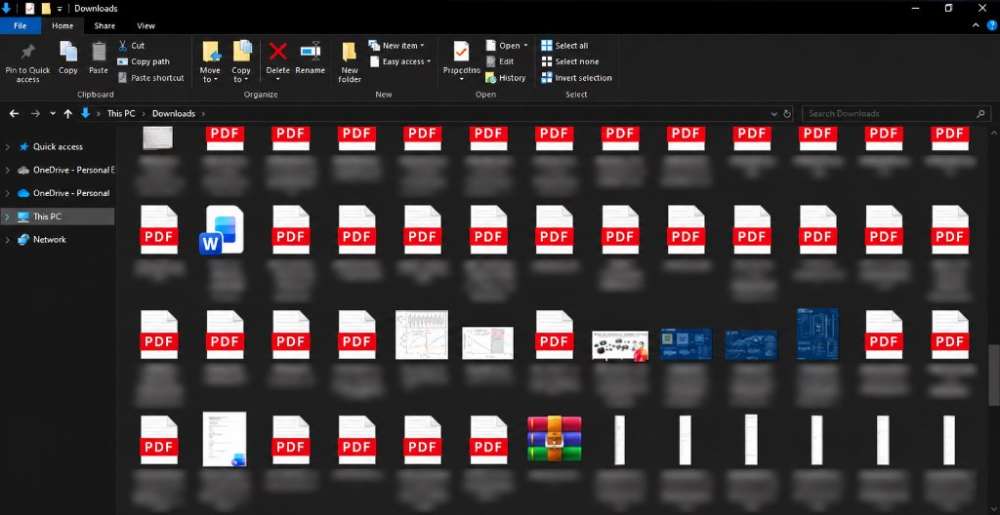

# FileFlow 📂⚡

**Intelligent Automated File Organization, Smart Sorting & Duplicate Cleaner for Windows**

*Tame folder chaos forever. Automatically organize in seconds what used to take an eternity.*

[](LICENSE)
[](https://microsoft.com/windows)
[](https://python.org)
[](https://reactjs.org)
[](https://github.com/nigam-30/fileflow/releases)

> 🚀 **Quick Download:** The pre-compiled standalone **`.exe`** installer is available in the **[Releases](https://github.com/nigam-30/fileflow/releases)** section. No technical setup, Python, or terminal commands needed!

  ---
---
## ⚡ TL;DR

- **What it is:** A free, open-source, 100% offline Windows desktop app that automatically organizes your messy folders (`Downloads`, `Desktop`, etc.) in real time.
- **How it works:** Set up custom rules once (by file extension, PDF text, image EXIF dates, or regex) and FileFlow auto-renames, sorts, compresses, or cleans up files in the background.
- **Standout features:** Ultra-fast 4-stage byte-for-byte duplicate finder, live dry-run rule simulator, safe Recycle Bin deletion, and zero cloud/account requirements.
- **Get started(For Users):** Grab `FileFlow-Setup-v1.0.1.exe` from **[Releases](https://github.com/nigam-30/fileflow/releases)**—no Python or terminal setup needed.
-  **Get started (For Developers):** Clone the repo, install Python (`requirements.txt`) & React (`npm run build`) dependencies, and run `python run.py`—see **[Building & Running from Source](#%EF%B8%8F-building--running-from-source-for-developers)**.

## 😫 The Problem: The Chaos & Endless Clutter

Almost every computer user's **`Downloads`** and **`Desktop`** folders eventually turn into a digital dumping ground. 

<div align="center">
  
  <p><em><b>Figure 1: The Everyday Nightmare.</b> Hundreds of unsorted PDFs, spreadsheets, slides, images, and archives scattered into an unmanageable mess.</em></p>
</div>

### Why Manual Organization Fails:
- 🤯 **Endless Drag & Drop**: Sorting dozens of files manually every day eats up hours of productive time.
- 🔍 **Documents Get Lost**: Critical invoices, bank statements, assignments, and receipts vanish beneath a mountain of random downloads.
- 📁 **`Document (1)_final_v2.pdf` Confusion**: Cryptic filenames make finding the right version nearly impossible.
- 💾 **Wasted Disk Space**: Accidental re-downloads create duplicate files that quietly consume gigabytes of storage.
- 💸 **Subscription Traps**: Existing proprietary tools charge monthly recurring fees, impose file limits, or send your confidential files to third-party cloud servers.

---

## 💡 The Solution: Enter FileFlow

**FileFlow** is a modern, 100% free, open-source, and offline desktop application designed specifically to eliminate folder clutter forever.

Define your organization rules once, select your origin folder (e.g. `Downloads`), and **FileFlow takes care of everything in real-time in the background**:

```
📥 New File Lands in Downloads 
         │
         ▼
⚡ FileFlow Detects & Debounces (Ensures file is fully downloaded)
         │
         ▼
🔍 Deep Content Extraction (PDF Text, EXIF Dates, Extensions, Regex Tokens)
         │
         ▼
📋 Evaluates Conditions (e.g. extension == "pdf", or content contains "Invoice")
         │
         ▼
🚀 Executes Actions: Auto-Rename & Move to Dedicated Structured Folders
```

No cloud dependencies, no accounts, no subscriptions, zero telemetry. Everything runs locally on your computer at lightning speed.

---

## ✨ The Result: Pure, Automated Order

With FileFlow active, the exact same cluttered directory is transformed into a clean, structured, and stress-free workspace:

<div align="center">
  
  <p><em><b>Figure 2: The FileFlow Result.</b> Files are instantly and automatically sorted into dedicated, clean category folders (<code>PDFS/</code>, <code>DOCX/</code>, <code>IMAGES/</code>, <code>XLSX/</code>, <code>PPTS/</code>, <code>SVG/</code>, <code>ZIPS/</code>) without you lifting a finger.</em></p>
</div>

> [!NOTE]
> **You have to create folders manually first, and then you can choose that as destination.**

---

## 🚀 Key Features

### 📁 1. Dedicated Origin & Watched Folders
- Assign specific origin folders to each rule (e.g., `Downloads`, `Desktop`, or custom client/project folders) using native Windows directory pickers.
- Supports multiple origin folders per rule or global system-wide automation.

### ⚡ 2. Instant Auto-Scan on Rule Creation
- As soon as you save or enable a rule, FileFlow **automatically sweeps and organizes existing files** in the origin directory right away—no waiting or manual scripts required.

### 🔍 3. 4-Stage Blazing Fast Duplicate Finder & Space Reclaimer
- High-performance multi-threaded engine (File Size $\rightarrow$ Head+Tail Dual Sample Hash $\rightarrow$ Full Parallel SHA-256 $\rightarrow$ Bit-for-Bit Binary Match) identifies true byte-for-byte duplicate files across any folder with zero false positives.
- Eliminates 99.9% of non-duplicates in microseconds without slow disk I/O, hashes candidate files in parallel across CPU cores, and verifies true duplicates bit-for-bit.
- Grouped duplicate review with SHA-256 checksum badges and safe one-click cleanup directly to the **Windows Recycle Bin**.

### 🧠 4. Deep Content & Metadata Extraction
- **System Attributes**: Extension, filename stem, file size (MB/KB), creation date, modification date.
- **PDF Text & Metadata**: Inspect document title, author, and full page text using `pypdf`.
- **Image EXIF**: Extract camera model, dimensions, and date taken using `Pillow`.
- **Regex Capture Groups**: Extract arbitrary regex tokens from filenames or document text into dynamic variables.

### 🛠️ 5. Dynamic File Actions & Templating
- **Move, Copy, Rename**: Structure your files into custom dynamic paths like:
  ```text
  D:/Documents/Organized/{file.created_year}/{file.created_date}_{file.name}
  ```
- **Collision Protection**: Automatically append counter suffixes (`(1)`, `(2)`), overwrite, or skip when filename conflicts occur.
- **Safe Recycle Bin Deletion**: Deletes files safely via the native Windows Recycle Bin using `send2trash`.
- **ZIP Compression**: Automatically bundle and compress matching files into `.zip` archives.

### 🧪 6. Live Rule Simulator Playground
- Test and verify how your rules will evaluate against any real file on your disk in dry-run mode before enabling automation.

### 🌓 7. Clean Light Mode by Default (+ Dark Mode)
- Features a clean, bright Light Mode by default, with a one-click toggle to a pure Dark Mode (`#000000`) for late-night workflows. Preferences persist across sessions.

### ⏱️ 8. Synced Activity Logs with 12-Hour Auto-Purge
- Real-time audit log of every file moved, renamed, or skipped, synchronized with your Windows system clock and timezone.
- Automatic background pruning purges logs older than 12 hours, keeping your database compact and responsive.

### 🔒 9. 100% Offline, Private & Persistent
- Your files never leave your machine.
- Rules and settings are safely stored in **`%APPDATA%\FileFlowData\fileflow.db`**, completely isolated from executable updates.

### 🗑️ 10. Complete Windows Uninstallation Support
- Registered under Windows **Settings → Apps → Installed apps** and **Control Panel** with full uninstaller support (`unins000.exe` and `uninstall.cmd`), allowing clean removal and optional rule preservation anytime.

### 🗔 11. Background Running with Windows System Tray
- Clicking the close button (`X`) minimizes FileFlow to the Windows notification tray instead of stopping your automation. Rules continue organizing files seamlessly in the background.
- Right-click tray menu provides instant controls: **Open FileFlow**, **Scan / Organize Now**, **Check for Updates**, and clean **Exit**.
- Windows notifications inform you when the app is minimized and when background tasks complete.

### ⚡ 12. Ultra-Lightweight RAM Footprint (~20–35 MB on 4GB PCs)
- Engineered specifically to run silently on low-spec/4GB RAM machines with minimal resource consumption.
- Automatically pauses UI polling when minimized via the **Page Visibility API**, eliminating CPU and React re-render churn.
- Uses Windows working set trimming (`EmptyWorkingSet`) on both Python and WebView2 helper processes, flushing idle cache to disk and dropping memory usage to under 35 MB in the tray.

### 🔔 13. In-App Update Notifications & Changelog
- Built-in GitHub Releases updater checks for new versions in the background with smart 2-hour caching.
- Clean notification banner and animated header badge alert you when an update is available.
- Interactive **Update Modal** lets you review what's new and download the latest installer with a single click.

---

## 🏗️ Architecture

FileFlow combines a high-performance Python engine with a modern, reactive user interface:

| Layer | Technologies |
|---|---|
| **Core Automation Engine** | Python 3.11+, FastAPI, Uvicorn, Watchdog |
| **System Tray & Memory** | Pystray, Psutil, Windows Win32 API (`EmptyWorkingSet`) |
| **Document & Media Parsers** | PyPDF, Pillow, Send2Trash |
| **Frontend UI** | React 18, TypeScript, Vite, Tailwind CSS, Lucide Icons |
| **Desktop Wrapper** | PyWebView (Microsoft Edge WebView2 Engine) |
| **Database** | SQLite3 (stored persistently in `%APPDATA%\FileFlowData`) |
| **Installer** | Inno Setup 6 (Single-file Windows Setup with native uninstaller) |

---

## 💾 Download & Install (For End Users)

> [!IMPORTANT]
> The pre-compiled Windows executable (`FileFlow-Setup-v1.0.2.exe`) is readily available in the **[Releases Section](https://github.com/nigam-30/fileflow/releases)**! 
> Zero technical knowledge required — you do **not** need to install Python, Node.js, or run any terminal commands.

1. Go directly to the **[Releases](https://github.com/nigam-30/fileflow/releases)** page on GitHub.
2. Under the latest release assets, download **`FileFlow-Setup-v1.0.2.exe`**.
3. Run the installer and launch FileFlow! It will run as a native desktop application.

---

## 🛠️ Building & Running from Source (For Developers)

### Prerequisites
- [Python 3.11+](https://www.python.org/)
- [Node.js 18+](https://nodejs.org/) & npm
- [Inno Setup 6](https://jrsoftware.org/isinfo.php) *(optional, only needed for compiling the Windows installer)*

### 1. Clone the Repository
```bash
git clone https://github.com/nigam-30/fileflow.git
cd fileflow
```

### 2. Install Dependencies & Build Frontend

**Install Backend Dependencies:**
```bash
pip install -r backend/requirements.txt
```

**Install Frontend Dependencies & Build:**
```bash
cd frontend
npm install
npm run build
cd ..
```
*(Building the frontend generates the production UI bundle required by the desktop window).*

---

### 3. Run FileFlow

#### Option A: Native Desktop App (Recommended)
Once the frontend is built, launch FileFlow directly from the root directory:
```bash
python run.py
```
*(Or run `python backend/run.py`)*

#### Option B: Full-Stack Dev Mode (Live Hot Reloading)
For active development with Vite instant reload:

1. **Terminal 1 (Backend Server):**
   ```bash
   cd backend
   python -m uvicorn src.api.server:app --reload --port 8765
   ```

2. **Terminal 2 (Frontend Dev Server):**
   ```bash
   cd frontend
   npm run dev
   ```
   Open **`http://localhost:3000`** in your browser. Changes will update in real time!

---

### 🧪 Running Developer Tests

Execute the automated test suite with `pytest`:
```bash
python -m pytest
```
Tests automatically verify rule conditions, content extraction, collision resolution, and database logging.

---

## 📦 Building Standalone `.exe` & Setup Installer

You can compile a self-contained desktop executable and installer with bundled assets and embedded icons:

```bash
# 1. Compile frontend build
cd frontend
npm run build
cd ..

# 2. Package executable using PyInstaller
python build_exe.py

# 3. (Optional) Compile single-file Windows Installer
iscc installer/FileFlow.iss
```

The compiled standalone executable and installer will be ready in:
```text
dist/FileFlow/FileFlow.exe
dist/FileFlow-Setup-v1.0.2.exe
```

---

## 🛡️ Privacy & Security

- **Zero Telemetry**: No user tracking, analytics, or remote calls.
- **Safe Deletion**: Files deleted by rules or duplicate cleanups go straight to your native OS Recycle Bin, allowing easy restoration.
- **Safe File Locking**: Real-time event debouncing ensures files are completely finished saving or downloading before any rule moves them.


## 🤝 Acknowledgements & Special Thanks

- **[Shravan / @shravan3161](https://github.com/shravan3161)** — Special thanks for rigorous QA testing, spotting duplicate detection bottlenecks, and validating developer test workflows.

## 📜 License

Distributed under the **MIT License**. Free for personal, commercial, and educational use. See `LICENSE` for details.
