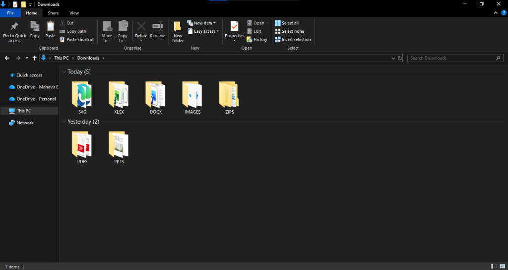

# FileFlow 📂⚡

**Intelligent Automated File Organization, Smart Sorting & Duplicate Cleaner for Windows**

*Tame folder chaos forever. Automatically organize in seconds what used to take an eternity.*

[](LICENSE)
[](https://microsoft.com/windows)
[](https://python.org)
[](https://reactjs.org)
[](#)

---

## 😫 The Problem: The Chaos & Endless Clutter

Almost every computer user's **`Downloads`** and **`Desktop`** folders eventually turn into a digital dumping ground. 

<div align="center">
  
  <p><em><b>Figure 1: The Everyday Nightmare.</b> Hundreds of unsorted PDFs, spreadsheets, slides, images, and archives scattered into an unmanageable mess.</em></p>
</div>

### Why Manual Organization Fails:
- 🤯 **Endless Drag & Drop**: Sorting dozens of files manually every day eats up hours of productive time.
- 🔍 **Documents Get Lost**: Critical invoices, bank statements, assignments, and receipts vanish beneath a mountain of random downloads.
- 📁 **`Document (1)_final_v2.pdf` Confusion**: Cryptic filenames make finding the right version nearly impossible.
- 💾 **Wasted Disk Space**: Accidental re-downloads create duplicate files that quietly consume gigabytes of storage.
- 💸 **Subscription Traps**: Existing proprietary tools charge monthly recurring fees, impose file limits, or send your confidential files to third-party cloud servers.

---

## 💡 The Solution: Enter FileFlow

**FileFlow** is a modern, 100% free, open-source, and offline desktop application designed specifically to eliminate folder clutter forever.

Define your organization rules once, select your origin folder (e.g. `Downloads`), and **FileFlow takes care of everything in real-time in the background**:

```
📥 New File Lands in Downloads 
         │
         ▼
⚡ FileFlow Detects & Debounces (Ensures file is fully downloaded)
         │
         ▼
🔍 Deep Content Extraction (PDF Text, EXIF Dates, Extensions, Regex Tokens)
         │
         ▼
📋 Evaluates Conditions (e.g. extension == "pdf", or content contains "Invoice")
         │
         ▼
🚀 Executes Actions: Auto-Rename & Move to Dedicated Structured Folders
```

No cloud dependencies, no accounts, no subscriptions, zero telemetry. Everything runs locally on your computer at lightning speed.

---

## ✨ The Result: Pure, Automated Order

With FileFlow active, the exact same cluttered directory is transformed into a clean, structured, and stress-free workspace:

<div align="center">
  
  <p><em><b>Figure 2: The FileFlow Result.</b> Files are instantly and automatically sorted into dedicated, clean category folders (<code>PDFS/</code>, <code>DOCX/</code>, <code>IMAGES/</code>, <code>XLSX/</code>, <code>PPTS/</code>, <code>SVG/</code>, <code>ZIPS/</code>) without you lifting a finger.</em></p>
</div>

---

## 🚀 Key Features

### 📁 1. Dedicated Origin & Watched Folders
- Assign specific origin folders to each rule (e.g., `Downloads`, `Desktop`, or custom client/project folders) using native Windows directory pickers.
- Supports multiple origin folders per rule or global system-wide automation.

### ⚡ 2. Instant Auto-Scan on Rule Creation
- As soon as you save or enable a rule, FileFlow **automatically sweeps and organizes existing files** in the origin directory right away—no waiting or manual scripts required.

### 🔍 3. 3-Stage Duplicate Finder & Space Reclaimer
- High-performance hashing engine (File Size $\rightarrow$ Header MD5 $\rightarrow$ Full SHA-256) identifies true byte-for-byte duplicate files across any folder.
- Grouped duplicate review with safe one-click cleanup directly to the **Windows Recycle Bin**.

### 🧠 4. Deep Content & Metadata Extraction
- **System Attributes**: Extension, filename stem, file size (MB/KB), creation date, modification date.
- **PDF Text & Metadata**: Inspect document title, author, and full page text using `pypdf`.
- **Image EXIF**: Extract camera model, dimensions, and date taken using `Pillow`.
- **Regex Capture Groups**: Extract arbitrary regex tokens from filenames or document text into dynamic variables.

### 🛠️ 5. Dynamic File Actions & Templating
- **Move, Copy, Rename**: Structure your files into custom dynamic paths like:
  ```text
  D:/Documents/Organized/{file.created_year}/{file.created_date}_{file.name}
  ```
- **Collision Protection**: Automatically append counter suffixes (`(1)`, `(2)`), overwrite, or skip when filename conflicts occur.
- **Safe Recycle Bin Deletion**: Deletes files safely via the native Windows Recycle Bin using `send2trash`.
- **ZIP Compression**: Automatically bundle and compress matching files into `.zip` archives.

### 🧪 6. Live Rule Simulator Playground
- Test and verify how your rules will evaluate against any real file on your disk in dry-run mode before enabling automation.

### 🌓 7. Clean Light Mode by Default (+ Dark Mode)
- Features a clean, bright Light Mode by default, with a one-click toggle to a pure Dark Mode (`#000000`) for late-night workflows. Preferences persist across sessions.

### ⏱️ 8. Synced Activity Logs with 12-Hour Auto-Purge
- Real-time audit log of every file moved, renamed, or skipped, synchronized with your Windows system clock and timezone.
- Automatic background pruning purges logs older than 12 hours, keeping your database compact and responsive.

### 🔒 9. 100% Offline, Private & Persistent
- Your files never leave your machine.
- Rules and settings are safely stored in **`%APPDATA%\FileFlowData\fileflow.db`**, completely isolated from executable updates.

### 🗑️ 10. Complete Windows Uninstallation Support
- Registered under Windows **Settings → Apps → Installed apps** and **Control Panel** with full uninstaller support (`unins000.exe` and `uninstall.cmd`), allowing clean removal and optional rule preservation anytime.

---

## 🏗️ Architecture

FileFlow combines a high-performance Python engine with a modern, reactive user interface:

| Layer | Technologies |
|---|---|
| **Core Automation Engine** | Python 3.11+, FastAPI, Uvicorn, Watchdog |
| **Document & Media Parsers** | PyPDF, Pillow, Send2Trash |
| **Frontend UI** | React 18, TypeScript, Vite, Tailwind CSS, Lucide Icons |
| **Desktop Wrapper** | PyWebView (Microsoft Edge WebView2 Engine) |
| **Database** | SQLite3 (stored persistently in `%APPDATA%\FileFlowData`) |
| **Installer** | Inno Setup 6 (Single-file Windows Setup with native uninstaller) |

---

## 💾 Download & Install (For End Users)

> [!TIP]
> **Zero technical knowledge required:** Regular users **do not** need Python, Node.js, npm, or terminal commands.

1. Go to the **[Releases](https://github.com/nigam-30/fileflow/releases)** section.
2. Download **`FileFlow-Setup-v1.0.0.exe`**.
3. Run the installer and launch FileFlow! It will start running as a native Windows desktop application.

---

## 🛠️ Building from Source (For Developers Only)

### Prerequisites
- [Python 3.11+](https://www.python.org/)
- [Node.js 18+](https://nodejs.org/) & npm
- [Inno Setup 6](https://jrsoftware.org/isinfo.php) (optional, for compiling the setup installer)

### 1. Clone Repository
```bash
git clone https://github.com/nigam-30/fileflow.git
cd fileflow
```

### 2. Backend Setup
```bash
cd backend
pip install -r requirements.txt
python run.py
```

### 3. Frontend Setup
```bash
cd frontend
npm install
npm run build
```

---

## 📦 Building Standalone `.exe` & Setup Installer

You can compile a self-contained desktop executable and installer with bundled assets and embedded icons:

```bash
# 1. Compile frontend build
cd frontend
npm run build
cd ..

# 2. Package executable using PyInstaller
python build_exe.py

# 3. (Optional) Compile single-file Windows Installer
iscc installer/FileFlow.iss
```

The compiled standalone executable and installer will be ready in:
```text
dist/FileFlow/FileFlow.exe
dist/FileFlow-Setup-v1.0.0.exe
```

---

## 🛡️ Privacy & Security

- **Zero Telemetry**: No user tracking, analytics, or remote calls.
- **Safe Deletion**: Files deleted by rules or duplicate cleanups go straight to your native OS Recycle Bin, allowing easy restoration.
- **Safe File Locking**: Real-time event debouncing ensures files are completely finished saving or downloading before any rule moves them.

---

## 📜 License

Distributed under the **MIT License**. Free for personal, commercial, and educational use. See `LICENSE` for details.
