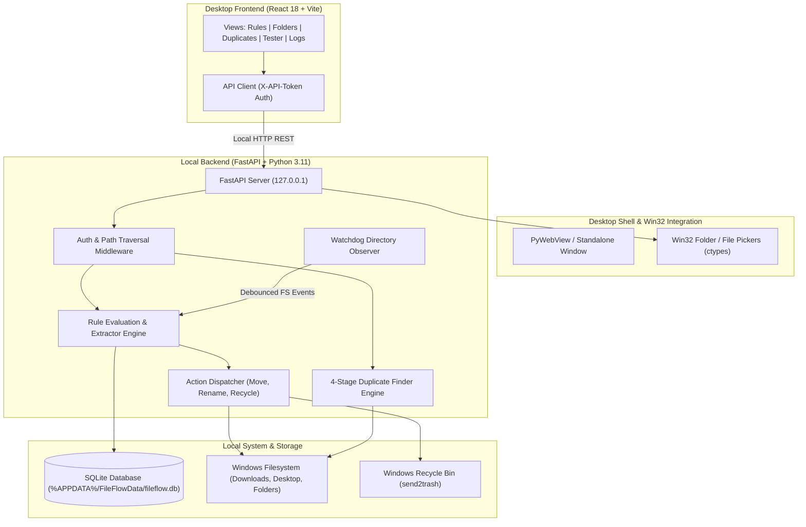

# Architecture

## 1. System Overview
FileFlow is a local, high-performance desktop application for Windows that combines a lightweight, modern web frontend (React 18 + TypeScript + Vite) with a resilient native Python automation engine (FastAPI, Uvicorn, Watchdog, SQLite). The architecture runs entirely offline on the client machine, providing sub-millisecond rule evaluation, low-latency filesystem event handling, and secure, isolated execution of file transformations.

## 2. Architecture Pattern
Pattern: Desktop Hybrid Modular Monolith (Local IPC via Loopback HTTP/REST + WebView Shell)
Reason:
- Decouples high-performance asynchronous file I/O and Windows filesystem monitoring from modern reactive user interface rendering.
- Allows native Windows API integration (Win32 folder browsing dialogs, `send2trash` Recycle Bin binding, PyInstaller executable bundling) while leveraging modern web components.
- Guarantees 100% offline isolation with zero remote attack surface.

## 3. Technology Stack
Frontend: React 18, TypeScript, Tailwind CSS, Vite, Lucide React
Backend: Python 3.11+, FastAPI, Uvicorn, Watchdog, Pydantic v2
Database: SQLite3 (Local file-based embedded storage with WAL mode)
Authentication: Local per-session API Token (`X-API-Token` header, 32-byte hex generated via `secrets.token_hex`)
Storage: Windows Local Filesystem (Target directories & `%APPDATA%\FileFlowData`)
Hosting / Packaging: Local desktop process, packaged as a standalone Windows binary via PyInstaller
Payments: None (100% Free and Open Source)
Email: None (No external email or cloud communications)
Analytics: None (Zero telemetry, zero tracking, strictly offline)
Other Services:
- `pypdf`: Local PDF text and metadata extraction
- `Pillow` (PIL): Image EXIF date and camera metadata parsing
- `send2trash`: Native Windows Recycle Bin deletion
- `ctypes` (`shell32`, `comctl32`): Native Win32 file and folder picker dialogs

## 4. System Components

### Frontend
Responsibilities:
- Provide an intuitive single-page interface for managing rules, monitored folders, duplicate scans, and audit logs.
- Manage local client state (active tab, theme toggling, form validation, filter queries).
- Communicate with the local backend via REST requests authenticated with `X-API-Token`.
- Deliver instant user feedback via dry-run simulation tables, dynamic templates, and duplicate review groupings.

### Backend (Automation Engine)
Responsibilities:
- Host local loopback REST API server (`127.0.0.1:<PORT>`) using FastAPI & Uvicorn.
- Monitor active origin directories recursively or non-recursively using `watchdog.observers.Observer`.
- Debounce and verify file read/write locks before firing rules on newly downloaded files.
- Run rule conditions against extracted metadata (system attributes, PDF text, EXIF headers).
- Dispatch safe file operations (move, copy, rename, recycle, compress, run command) with collision resolution.
- Execute the 4-stage duplicate detection pipeline across multiple CPU threads.

### Database (Persistence Layer)
Responsibilities:
- Maintain application state: rules, monitored folder registrations, duplicate scan checkpoints, and operation audit logs.
- Prevent duplicate processing loops by tracking recently processed file paths, hashes, and timestamps (`processed_files`).
- Automatically purge historical audit records exceeding retention thresholds.

## 5. Architecture Diagram



## 6. Data Flow

### Scenario A: Incoming File Automated Organization
1. A new file is downloaded or saved to a monitored directory (e.g., `Downloads/invoice.pdf`).
2. `DirectoryWatcher` captures the filesystem `created` / `modified` event.
3. Debounce handler verifies the file is fully written and no longer locked by the browser or writing application.
4. `RuleEngine` queries active rules from the database that match the origin directory.
5. Extractor modules read metadata (system file size, PDF text, creation timestamp).
6. Engine evaluates conditions in sequence (`ALL` / `ANY`).
7. Once a rule matches:
   - File collision check is evaluated (`rename_with_counter`, `skip`, `overwrite`).
   - `ActionDispatcher` performs the requested actions (e.g., moves file to `Documents/Invoices/2026/`).
   - File path, hash, and timestamp are committed to `processed_files` to avoid re-trigger loops.
   - Result is logged to `audit_logs` table.
8. If the UI is open, the Audit Log updates.

### Scenario B: Duplicate Detection & Cleanup
1. User selects target folder in UI and clicks "Start Scan".
2. Frontend issues `POST /api/duplicates/scan` with selected path.
3. Backend `DuplicateFinder` executes:
   - Stage 1: Groups files by exact file size.
   - Stage 2: Hashes head and tail chunks (64 KB each) of candidates.
   - Stage 3: Generates full SHA-256 hashes in parallel using worker threads.
   - Stage 4: Compares binary byte-by-byte for final group validation.
4. Grouped results returned to frontend with SHA-256 tags.
5. User selects duplicates and clicks "Clean to Recycle Bin".
6. Backend uses `send2trash` to safely move files without permanent data destruction.

## 7. Project Structure
```
FileFlow/
├── assets/                  # Application branding and media
├── docs/                    # Architectural and project documentation
├── fileflow/
│   ├── backend/
│   │   ├── src/
│   │   │   ├── actions/     # Action execution & collision dispatchers
│   │   │   ├── api/         # FastAPI router, endpoints & security middleware
│   │   │   ├── core/        # Engine, Watcher, Database, Duplicate Finder
│   │   │   ├── extractors/  # System, PDF, Media EXIF, Text parsers
│   │   │   └── main.py      # Entry point & PyWebView lifecycle
│   │   ├── tests/           # Pytest unit & integration test suites
│   │   └── requirements.txt # Python package dependencies
│   ├── frontend/
│   │   ├── src/
│   │   │   ├── components/  # React modular views & modals
│   │   │   ├── types/       # TypeScript interface definitions
│   │   │   ├── utils/       # Win32 file picker bridge & helpers
│   │   │   ├── App.tsx      # Main application state and tab routing
│   │   │   └── main.tsx     # React DOM root entry
│   │   ├── package.json     # Node packages & scripts
│   │   └── vite.config.ts   # Vite bundler configuration
│   └── installer/           # PyInstaller spec & Inno Setup scripts
└── README.md                # Project landing documentation
```

## 8. Dependency Rules
- Frontend components must interact with backend capabilities only through the typed REST API (`/api/*`); never invoke shell commands or disk I/O directly from frontend scripts.
- Extractors must remain decoupled from specific actions; an extractor only outputs structured dictionaries of file metadata.
- Database operations must use parameterized queries exclusively; no raw string concatenation is permitted.
- File operations that delete or modify user data must default to non-destructive methods (`send2trash`) unless explicitly overridden with user confirmation.

## 9. Key Technical Decisions

### Decision: Local Loopback REST API vs. Native C++ / Rust Bindings
- Context: Need for high performance, modern cross-platform UI, and rapid development of complex rule engines.
- Alternatives: Electron + Node.js, C++ Qt, C# WPF, Rust Tauri.
- Reason: Python provides rich file parsing libraries (`pypdf`, `Pillow`, `watchdog`) and fast iteration, while FastAPI + React creates an exceptionally clean, responsive UI with tiny memory footprint compared to heavy Electron builds.

### Decision: 4-Stage Hierarchical Duplicate Finder
- Context: Scanning 50,000+ files for duplicates can stall disk drives if computing full SHA-256 hashes on every file.
- Alternatives: Direct full hashing of every file, size-only matching.
- Reason: Size check eliminates 95% of candidates instantaneously; Head+Tail dual sampling eliminates 95% of the remainder with only two 64 KB reads; full SHA-256 runs only on identical candidates; bit-for-bit check provides mathematical certainty against collisions.

### Decision: Recycle Bin as Default Deletion Strategy
- Context: Automation software must prevent accidental irreversible data loss.
- Alternatives: Hard `os.remove`, quarantine folder.
- Reason: Moving files to the native Windows Recycle Bin allows users to restore any mistakenly matched files via standard Windows Explorer tools.

## 10. Performance Considerations
- Database is tuned with SQLite `WAL` (Write-Ahead Logging) mode to prevent concurrency locks between directory watcher threads and UI read queries.
- Filesystem event notifications are debounced using a 500ms sliding window to prevent duplicate executions during large multi-megabyte file transfers.
- Full-text PDF extraction parses only the first 5 pages by default to prevent thread starvation on 500-page academic textbooks.

## 11. Scalability Considerations
- Handles folders containing up to 100,000 files using batched database pagination and streaming generator loops.
- Multi-core CPU utilization during duplicate scanning via Python's `concurrent.futures.ThreadPoolExecutor`.

## 12. Failure Scenarios
- **What happens if Database is locked or unavailable?**
  Database initialisation falls back to retry loops with timeouts; if corrupted, the system creates a timestamped backup and re-initializes a clean schema while logging the incident.
- **What happens if a monitored file is locked by another process?**
  The engine tests file lock handles with exponential backoff (up to 3 retries). If still locked, the event is deferred or logged as skipped.
- **What happens if destination path disk is full?**
  The action fails safely before removing the source file, records an error entry in `audit_logs`, and notifies the user without corrupting data.
- **What happens if API authentication fails?**
  Requests missing or mismatched with `X-API-Token` receive `403 Forbidden` and are rejected before touching core services.
