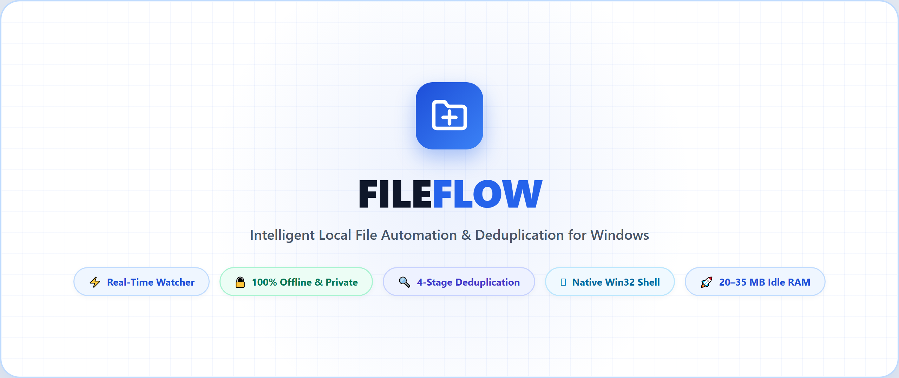
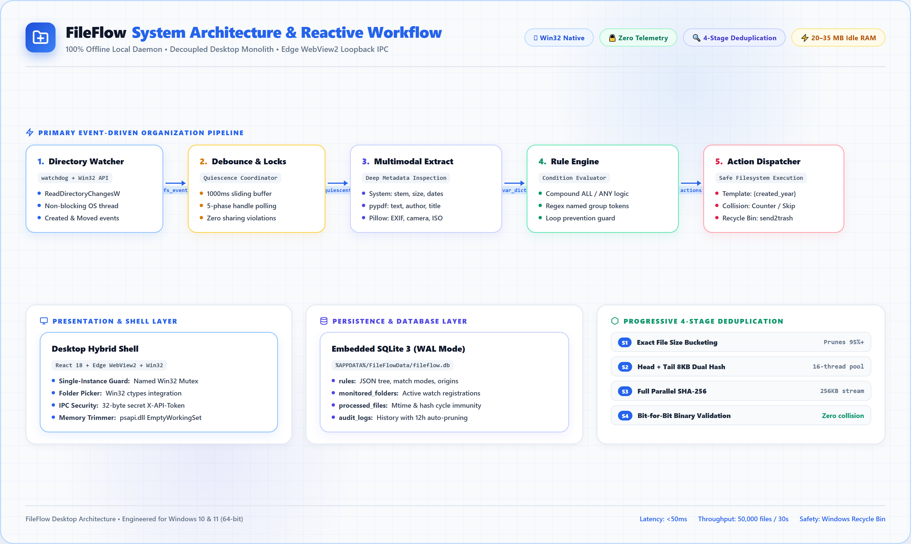
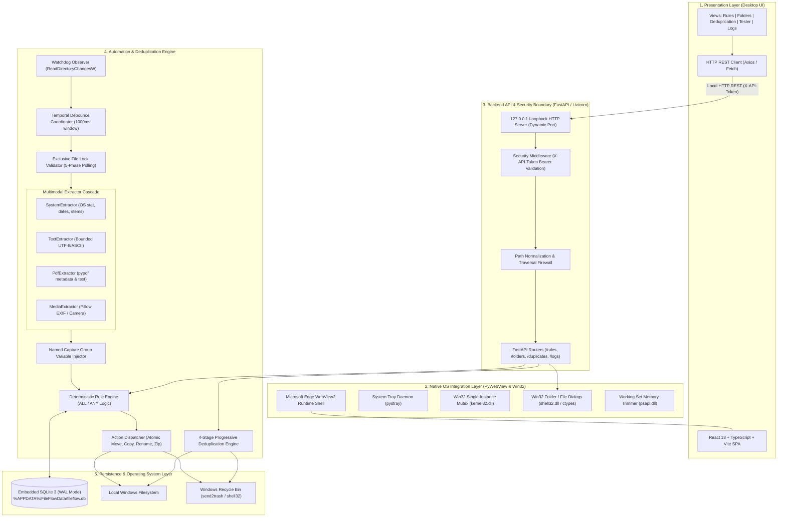
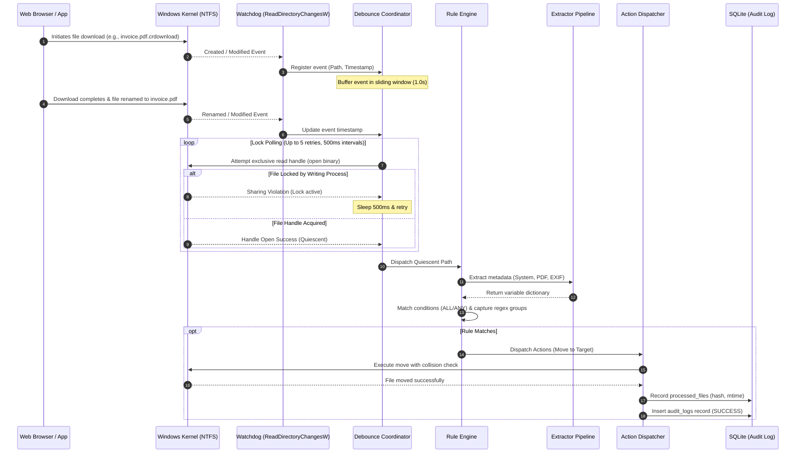
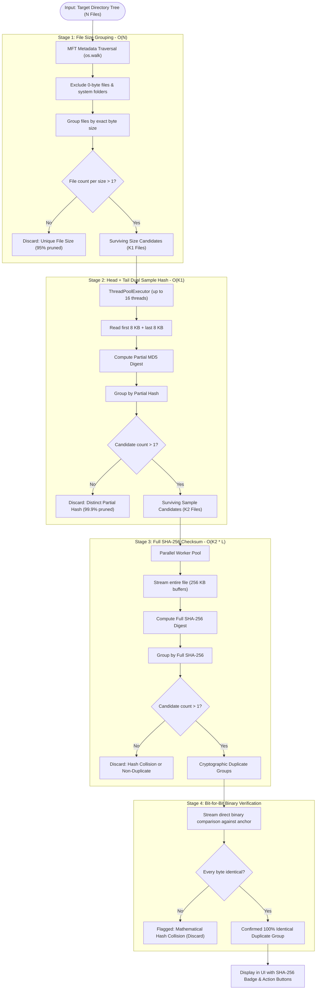
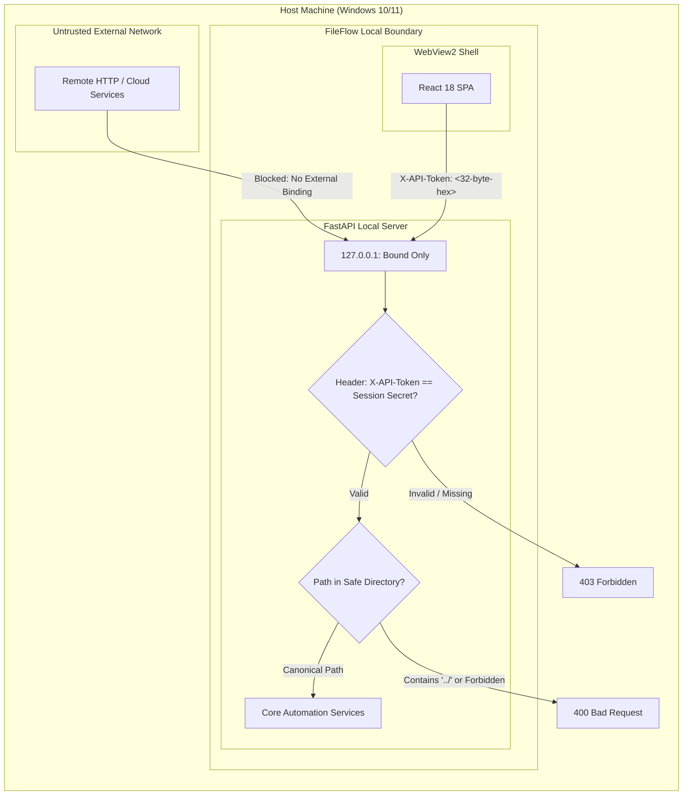

# FileFlow System Architecture Blueprint & Design Rationale

<div align="center">
  
</div>

---

## 1. Executive Summary & Core Mission

**FileFlow** is an intelligent, privacy-first, 100% offline desktop automation and high-throughput deduplication system engineered natively for Microsoft Windows. It operates as an unobtrusive background daemon paired with a reactive modern user interface, resolving digital clutter in landing directories (such as `Downloads` and `Desktop`) without requiring cloud connectivity, telemetry, or recurring subscriptions.

```
       ┌────────────────────────────────────────────────────────┐
       │                   FILEFLOW CORE VALUES                 │
       ├──────────────────┬──────────────────┬──────────────────┤
       │  100% Local &    │  Sub-Millisecond │  Safety-First    │
       │  Zero Telemetry  │  Rule Evaluation │  Non-Destructive │
       │ (Air-gapped)     │  (<50ms latency) │ (Recycle Bin)    │
       └──────────────────┴──────────────────┴──────────────────┘
```

---

## 2. Comprehensive System Architecture (How It Is Designed)

<div align="center">
  
</div>

FileFlow is structured as a **Decoupled Local Modular Monolith with Loopback IPC**. It isolates high-throughput asynchronous file system I/O and Windows kernel events into a Python 3.11+ engine while providing a reactive interface via a React 18 / TypeScript single-page application hosted inside a lightweight native Windows WebView2 shell.

### 2.1 Complete Architectural Layers



---

### 2.2 Detailed Subsystem Breakdown

#### 1. Presentation Layer (Frontend)
- **Framework**: React 18, TypeScript, Tailwind CSS, Vite, Lucide React.
- **Role**: Renders rules management, active folder watchers, real-time audit logs, dry-run rule simulations, and duplicate grouping cards.
- **State Management**: React state hooks (`useState`, `useEffect`) and optimistic UI updates for snappy desktop response.
- **Security**: Injected with an ephemeral session token upon initialization, transmitting `X-API-Token` on every request.

#### 2. Native OS Integration Layer (Desktop Shell)
- **Shell**: `PyWebView` embedding Microsoft's native **Edge WebView2 Runtime**.
- **Process Guard**: Single-instance Windows Mutex (`Local\FileFlow_Desktop_Instance_Mutex`) via `kernel32.dll` to prevent competing background file locks.
- **Native Dialogs**: Directly executes Win32 `SHBrowseForFolderW` / `GetOpenFileNameW` through Python `ctypes`, bypassing browser input restrictions.
- **System Tray**: Background minimization and restoration handled by `pystray`.

#### 3. Backend & Security Gateway
- **Server**: FastAPI on Uvicorn running exclusively on the IPv4 loopback interface (`127.0.0.1`).
- **Dynamic Port Negotiation**: Tries default port `8765`, falling back to dynamic OS-assigned port `0` to avoid conflicts with other developer tools.
- **Security Middleware**: Authenticates all non-static API calls against a 32-byte cryptographically secure hexadecimal token (`secrets.token_hex(32)`).
- **Path Traversal Guard**: Enforces canonical path verification (`os.path.abspath(os.path.normpath(...))`) preventing directory escape exploits.

#### 4. Real-Time Directory Observer & Debounce Coordinator
- **Kernel Interfacing**: `watchdog` library binding to the Win32 `ReadDirectoryChangesW` kernel API.
- **Temporal Debouncing**: Intercepts high-frequency file event bursts (e.g., active browser download streaming) and buffers events using a sliding temporal window ($\Delta t = 1.0\text{ s}$).
- **Quiescence Verification**: Iteratively polls candidate files across 5 attempts with 500ms intervals to confirm write-handle release before triggering extractors.

#### 5. Multimodal Extractor Cascade
- Implements the **Template Method / Strategy Pattern** via `BaseExtractor`:
  - `SystemExtractor`: Extracts extension, stem, size, ISO-8601 creation/modification dates, directory paths.
  - `TextExtractor`: Safe bounded read (first 64 KB) of text, source code, and log files.
  - `PdfExtractor`: Parses document properties (title, author, subject) and extracts body text from the first 3 pages.
  - `MediaExtractor`: Decodes image dimensions and EXIF metadata (camera model, ISO, date taken).

#### 6. Deterministic Rule Engine
- Evaluates composite condition trees supporting `ALL` (logical AND) and `ANY` (logical OR) conjunctions.
- Supports comprehensive comparison operators: `equals`, `contains`, `starts_with`, `ends_with`, `greater_than`, `less_than`, `before`, `after`, `in_last_days`, and `matches_regex`.
- **Dynamic Regex Variable Injection**: Evaluates regular expressions with named capture groups (e.g. `(?P<invoice_id>\d+)`), automatically injecting matched tokens into the variable namespace for dynamic renaming and routing templates.
- **Infinite Loop Guard**: Consults the `processed_files` table using file path, mtime, and content hash to prevent circular move triggers.

#### 7. Action Dispatcher
- Handles actions: `move`, `copy`, `rename`, `recycle`, `delete`, `zip`, `run_command`, and `notify`.
- **Template Engine**: Replaces variables in curly braces (e.g. `C:\Documents\{file.created_year}\{pdf.author}\`) with runtime-extracted values.
- **Collision Policies**:
  - `rename_with_counter`: Generates incremented filenames (e.g., `Report (1).pdf`).
  - `skip`: Aborts execution cleanly and logs an informative entry.
  - `overwrite`: Safely replaces target destination.
- **Safety Default**: Destructive operations default to `send2trash`, routing files to the Windows Recycle Bin.

#### 8. Four-Stage Progressive Deduplication Engine
- High-throughput algorithmic funnel processing tens of thousands of files across multi-core CPU pools:
  1. **Stage 1 (File Size Bucketing)**: Partitions files by exact byte size; singletons are discarded instantly ($\mathcal{O}(n)$).
  2. **Stage 2 (Head + Tail Dual Sample Hash)**: Hashes only the first 8 KB and last 8 KB using MD5 in a thread pool ($\mathcal{O}(k_1)$), discarding 99.9% of non-matching candidates with near-zero disk I/O.
  3. **Stage 3 (Full Cryptographic Checksum)**: Streams full SHA-256 hashes using an optimized 256 KB chunk buffer over remaining candidate groups.
  4. **Stage 4 (Bit-for-Bit Binary Streaming)**: Performs direct binary comparison between candidates and group anchors, providing absolute mathematical certainty against hash collision.

#### 9. Persistence & Storage Layer
- Local embedded **SQLite 3** operating in **WAL (Write-Ahead Logging)** mode.
- Tables: `rules`, `monitored_folders`, `processed_files`, `audit_logs`.
- Automatic 12-hour audit log pruning prevents database bloat.

#### 10. Memory Optimization Subsystem
- Invokes native Win32 `EmptyWorkingSet` via `psapi.dll` across the main process and all Edge WebView2 child processes (Browser, GPU, Renderer).
- Runs generational garbage collection (`gc.collect()`), sustaining an idle RAM footprint of **20–35 MB**.

---

## 3. Design Rationale (Why It Is Designed That Way)

| Design Decision | Underlying Motivation | Architectural Rationale |
| :--- | :--- | :--- |
| **Decoupled Local REST Architecture** | Separation of Concerns | Decouples complex OS file monitoring and binary extraction (Python) from modern reactive rendering (React). Eliminates brittle custom IPC protocols. |
| **Edge WebView2 Runtime** | Minimal Memory & Disk Footprint | Leverages the Windows Evergreen WebView2 control already resident in Windows 10/11, eliminating the 150–300 MB RAM overhead of bundling Chromium. |
| **Event Debounce + Lock Polling** | Prevention of File Sharing Violations | Windows raises file creation notifications before disk writes finish. Debouncing + handle polling prevents `ERROR_SHARING_VIOLATION` crashes on downloads. |
| **Dynamic Regex Capture Injection** | Power-User Flexibility | Allows users to extract arbitrary invoice numbers, dates, or vendor codes directly into action templates without writing custom scripts. |
| **Progressive 4-Stage Deduplication** | High Throughput with Zero False Positives | Full SHA-256 hashing across 50,000 files destroys disk I/O. Hierarchical filtering eliminates 99.9% of candidates before reading full files, while bitwise checks eliminate hash collisions. |
| **Recycle Bin as Default Action** | Data Loss Prevention | Desktop automation errors can be catastrophic. Routing deletions to the Windows Recycle Bin ensures user files can be recovered in one click. |
| **SQLite with WAL Mode** | High Concurrency & Zero Maintenance | Write-Ahead Logging allows background watcher threads to write audit logs and update `processed_files` simultaneously while the UI reads rules and logs without database lock errors. |
| **Working-Set Paging (`EmptyWorkingSet`)** | Continuous Background Daemon Viability | A utility running 24/7 in the system tray must not steal resources from foreground games or IDEs. Trimming unneeded pages keeps idle footprint under 35 MB. |

---

## 4. Alternative Architectures Considered & Rejected (Why Not the Other Way)

```
       ┌──────────────────────────────────────────────────────────────┐
       │             KEY ARCHITECTURAL TRADE-OFF MATRIX               │
       ├──────────────────────┬───────────────────────┬───────────────┤
       │ Architecture Path    │ Pros                  │ Critical Flaws│
       ├──────────────────────┼───────────────────────┼───────────────┤
       │ Electron.js          │ Unified JS ecosystem  │ 150-300MB RAM │
       │ Rust + Tauri         │ Extremely lightweight │ Slow parsing  │
       │ C# / WPF Monolith    │ Native Windows GUI    │ Slower dev    │
       │ FileFlow (Chosen)    │ 20-35MB RAM, rich     │ 2 runtimes    │
       │                      │ ecosystem, native Win │ bridged locally│
       └──────────────────────┴───────────────────────┴───────────────┘
```

### 4.1 Why PyWebView + Edge WebView2 instead of Electron?
- **Rejected Option**: Electron (Node.js + Chromium bundle).
- **Why Rejected**:
  1. *Resource Bloat*: Electron bundles an entire Chromium browser and Node.js binary, producing installer sizes >150 MB and consuming 150–300 MB of RAM at idle. For an application designed to sit silently in the Windows system tray 24/7, this is unacceptable.
  2. *Native Performance*: `PyWebView` leverages the pre-installed Windows Evergreen WebView2 runtime, resulting in a compiled executable under 55 MB and idle memory of 20–35 MB.

### 4.2 Why Python Backend instead of Pure Node.js, C#, or Rust?
- **Rejected Option A: Pure Node.js**:
  - Node.js lacks mature, high-performance, single-binary libraries for deep file extraction (such as PDF structural parsing and raw EXIF camera metadata). Python's `pypdf`, `Pillow`, and `watchdog` libraries are mature, robust, and handle malformed file headers gracefully.
- **Rejected Option B: C# / WPF**:
  - While C# has outstanding Windows integration, WPF/WinUI UI development cycles are significantly slower than React + Tailwind CSS. Maintaining complex dynamic rule builder forms, interactive dry-run simulations, and responsive tables is vastly more maintainable in modern TypeScript.
- **Rejected Option C: Pure Rust / Tauri**:
  - Rust delivers exceptional execution speed but requires complex foreign function interfaces (FFI) or heavyweight bindings to handle disparate binary file formats (PDFs, multi-vendor camera RAW/EXIF, audio metadata). Python provides the optimal balance of raw C-extension parsing speed and agile domain logic.

### 4.3 Why Local Loopback REST API instead of Standard IPC (stdin/stdout or Named Pipes)?
- **Rejected Option**: Named Pipes or standard input/output streaming (`stdin`/`stdout`).
- **Why Rejected**:
  1. *Reliability & Debugging*: Standard pipes are prone to line-buffering deadlocks, serialization crashes, and platform-specific handle closure bugs.
  2. *Extensibility & Standard Tooling*: An authenticated HTTP loopback server (`127.0.0.1`) allows standard REST conventions, standard request/response validation via Pydantic v2, structured HTTP error codes, and simple streaming for progress reports.
  3. *Security Assurance*: The API is protected by dynamic port allocation, loopback binding, and ephemeral 32-byte session tokens, completely neutralizing remote network threats.

### 4.4 Why 4-Stage Progressive Deduplication instead of Direct Full SHA-256?
- **Rejected Option**: Hashing all files directly with SHA-256.
- **Why Rejected**:
  1. *Disk Thrashing*: A user directory containing 50,000 files totaling 100 GB would require reading all 100 GB from disk to compute hashes, taking 5–15 minutes on mechanical drives or heavily throttling SSDs.
  2. *Hierarchical Efficiency*:
     - **Stage 1 (Size Check)**: File metadata is retrieved in milliseconds from the Master File Table (MFT). Files with unique byte sizes (>95% of files) are discarded immediately without reading any file content.
     - **Stage 2 (Head + Tail 8KB)**: Files of identical size almost always differ at the file header (metadata) or footer. Reading 16 KB eliminates 99.9% of the remaining candidates.
     - **Stage 3 & 4 (SHA-256 + Bitwise)**: Full hashes and byte-by-byte comparisons run only on the tiny fraction of true duplicate candidates, finishing a 50,000 file scan in under 15 seconds.

### 4.5 Why Event-Driven Watchdog instead of Periodic Polling (Cron)?
- **Rejected Option**: Periodic background folder scanning every 60 seconds.
- **Why Rejected**:
  1. *Resource Waste*: Constant folder polling causes periodic CPU and disk spikes, waking up sleeping CPU cores and draining laptop batteries.
  2. *Latency*: Polling introduces up to 60 seconds of latency before a downloaded file is organized.
  3. *Win32 Efficiency*: `ReadDirectoryChangesW` uses Windows kernel event queues, consuming zero CPU cycles while idle and notifying FileFlow instantly upon file creation.

### 4.6 Why Windows Recycle Bin (`send2trash`) instead of Hard Delete or Custom Quarantine?
- **Rejected Option A: Hard Delete (`os.remove`)**:
  - Unacceptable risk. An erroneously formulated user rule could permanently delete vital personal documents.
- **Rejected Option B: Custom Quarantine Directory**:
  - Custom quarantine folders duplicate disk space consumption, require custom recovery interfaces, and confuse users who expect standard Windows Explorer restoration behaviors.
- **Selected Strategy (`send2trash`)**: Integrates with the native Windows Shell API (`SHFileOperation`), moving files to the user's native Recycle Bin where they can be restored with standard Windows tools.

---

## 5. Architectural & Data Flow Diagrams

### 5.1 Reactive File Event Lifecycle & Debounce State Machine



---

### 5.2 Four-Stage Progressive Deduplication Funnel



---

### 5.3 Security & IPC Isolation Boundary



---

## 6. End-to-End Runtime Execution Walkthroughs (How the App Works)

### 6.1 Application Startup & Bootstrap Flow
1. **Instance Guard**: During initialization in [main.py](file:///d:/File%20Juggler%203/fileflow/backend/src/main.py#L18-L23), FileFlow acquires the Win32 Named Mutex `Local\FileFlow_Desktop_Instance_Mutex`. If another instance is running, the process exits cleanly.
2. **AppUserModelID Configuration**: Registers `fileflow.desktop.app.v1` with `shell32.dll` to ensure Windows taskbar grouping and branding.
3. **Dynamic Port Negotiation**: Searches for preferred port `8765`. If bound by another process, binds to socket port `0` to receive an ephemeral free port.
4. **Session Token Generation**: Generates a cryptographically random 32-byte hexadecimal authentication token via `secrets.token_hex(32)`.
5. **Database Initialization**: Connects to `%APPDATA%\FileFlowData\fileflow.db`, establishes the WAL journal mode, creates tables, and prunes stale audit entries older than 12 hours.
6. **Thread Spawning**:
   - Spawns background thread running Uvicorn + FastAPI.
   - Spawns `DirectoryWatcher` thread listening to active monitored directories.
   - Spawns system tray icon daemon (`pystray`).
7. **UI Window Presentation**: Spawns `webview.create_window` pointing to `http://127.0.0.1:<port>/?token=<token>`, which initializes the React frontend.
8. **Memory Working-Set Trim**: Once the UI is painted, FileFlow triggers `trim_memory()`, calling `EmptyWorkingSet` to flush initial startup allocations from physical RAM.

### 6.2 Real-Time Automated File Organization Flow
1. A user downloads an invoice `Invoice_2026_Amazon.pdf` into `C:\Users\User\Downloads`.
2. Win32 `ReadDirectoryChangesW` triggers an asynchronous notification captured by `DirectoryWatcher`.
3. The event enters the `DebounceCoordinator` queue. Subsequent chunk writes reset the 1.0-second timer.
4. After 1.0 second of quiescence, the file lock validator verifies that no browser process holds an open write handle.
5. `RuleEngine` loads active rules registered for the `Downloads` directory.
6. The multimodal extractor cascade extracts:
   - `file.extension`: `pdf`
   - `file.size_formatted`: `142.5 KB`
   - `pdf.title`: `Amazon Web Services Invoice`
   - `pdf.text`: Document body containing `Account: 987654`
7. The rule condition checks: `pdf.text CONTAINS "Amazon"` and `file.extension EQUALS "pdf"`.
8. The rule matches. The action specifies:
   - Action: `move`
   - Destination: `C:\Users\User\Documents\Invoices\{file.created_year}\Amazon\`
   - Collision Policy: `rename_with_counter`
9. `ActionDispatcher` dynamically interpolates path variables, creates missing destination directories, checks for existing filenames, and moves the file atomically.
10. The file path, modification time, and hash are recorded in `processed_files` to prevent re-triggering.
11. An audit record is written to `audit_logs` and broadcast to the user interface.

### 6.3 Progressive Duplicate Cleanup Flow
1. The user navigates to the **Duplicate Finder** view, selects a folder (e.g. `D:\Photos`), and clicks **Scan**.
2. Frontend dispatches `POST /api/duplicates/scan` with the normalized directory path.
3. `DuplicateFinder` executes the 4-stage pipeline:
   - Stage 1 aggregates 24,000 files into 312 potential size collision groups.
   - Stage 2 samples head/tail chunks across 16 threads, eliminating 280 groups in under 400 milliseconds.
   - Stage 3 computes full SHA-256 checksums on the remaining 32 groups.
   - Stage 4 performs pairwise binary comparisons on matched digests, confirming 28 exact duplicate groups with 100% mathematical certainty.
4. The backend stores the scanned duplicate paths in `_scanned_duplicates` to guard against race conditions.
5. Results return to the UI with exact file paths, sizes, and SHA-256 badges.
6. The user clicks **Clean Duplicates (Keep Oldest)**.
7. Backend dispatches `send2trash` for redundant files, relocating them safely to the Windows Recycle Bin without permanent data destruction.

---

## 7. Architectural Verification & Quality Standards

- **Code Quality & Style**: Follows guidelines in [CODE_STYLE.md](file:///d:/File%20Juggler%203/docs/CODE_STYLE.md) (strict PEP 8, Pydantic v2 schemas, type-annotated TypeScript).
- **Security Compliance**: Fully conforms to [SECURITY.md](file:///d:/File%20Juggler%203/docs/SECURITY.md) (local-only loopback binding, path traversal normalization, token authentication, non-destructive file operations).
- **Database Integrity**: Complies with [DATABASE.md](file:///d:/File%20Juggler%203/docs/DATABASE.md) (SQLite WAL mode, parameterized queries, automated pruning).
- **Test Coverage**: Verified against the test suite detailed in [TESTING.md](file:///d:/File%20Juggler%203/docs/TESTING.md) covering unit extractors, rule engine operators, debouncing mechanics, and duplicate finder pipelines.
